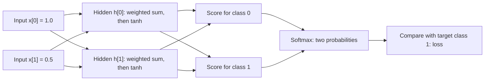

# A tiny network: every number in one learning step

Read [the foundations](01_foundations.md) first. Keep
[the matching Python lesson](../lessons/02_tiny_network.py) open beside this
page. This lesson comes **before** the general [backpropagation derivation](02_backpropagation.md).
Both files begin with `02` to keep existing links working; follow this order.

We will use two inputs, two hidden neurons, and two output classes. There is
only **one example** and **one update**. The inputs are invented numbers, not
an MNIST image. Class IDs 0 and 1 are just names for the two possible answers.

Run from the repository root:

```bash
python lessons/02_tiny_network.py
```

On Windows, with the environment from the README:

```powershell
.venv\Scripts\python.exe lessons/02_tiny_network.py
```

The lesson itself only needs Python's standard library. It prints the numbers
below, keeping full precision internally and rounding to six decimals for
display. If you calculate with rounded values, the last digit may differ.

## 1. Draw the route from input to prediction



Every hidden neuron receives both inputs. Every output receives both hidden
activations. Each hidden and output neuron also has a bias, omitted from the
diagram to keep the connections readable.

The input stays fixed during this step. The weights and biases are what we
change. The target is used to measure loss; it is not fed into the prediction.

## 2. Name the numbers we can learn

```text
x = [1.0, 0.5]       target = 1       learning_rate = 0.1

W1 = [[0.1, -0.2],   b1 = [0.0, 0.2]
      [0.4,  0.2]]

W2 = [[ 0.3, -0.1],  b2 = [0.1, -0.1]
      [-0.2,  0.4]]
```

`W1` connects inputs to hidden neurons. `W2` connects hidden neurons to output
classes. `b1` and `b2` hold their biases. The numbers are deliberately fixed so
you can reproduce the arithmetic. The main MNIST network starts with random
weights instead.

For both weight tables, **row = source, column = destination**. Python starts
indexing at zero. For example, `W1[1][0] = 0.4` connects the second input to the
first hidden neuron. Each column contains the incoming weights of one neuron.

There are 4 + 2 + 4 + 2 = **12 learned parameters**. Inputs, target, and learning
rate are not learned parameters in this example.

## 3. Calculate the two hidden neurons

A neuron's weighted sum means: multiply each input by its connection weight,
add those products, and add the bias.

```text
z1[0] = 1.0 * 0.1  + 0.5 * 0.4 + 0.0 = 0.3
z1[1] = 1.0 * -0.2 + 0.5 * 0.2 + 0.2 = 0.1
```

Next apply **tanh**, a nonlinear function mapping numbers into (-1, 1):

```text
tanh(z) = (exp(z) - exp(-z)) / (exp(z) + exp(-z))
h[0] = tanh(0.3) = 0.291313
h[1] = tanh(0.1) = 0.099668
```

`exp(z)` means e raised to z, where e is approximately 2.71828. You may use a
calculator for tanh and exp; the point is to follow the information flow.
The hidden values are intermediate features computed by the model, not class
probabilities. Nonlinearity prevents the whole network from collapsing into
one affine transformation. An affine transformation is a weighted sum plus a bias.

## 4. Calculate the two output scores

Repeat the weighted-sum calculation, now using hidden values as inputs:

```text
score[0] = h[0] * 0.3  + h[1] * -0.2 + 0.1  =  0.167460
score[1] = h[0] * -0.1 + h[1] * 0.4  - 0.1  = -0.089264
```

These scores are also called **logits**. They can be negative and need not sum
to one. Class 0 currently has the higher score, although the true class is 1.

## 5. Turn scores into probabilities with softmax

Softmax exponentiates each score and divides by the sum of both exponentials.
We first subtract the largest score from both. This does not change the
result: the same factor would cancel from numerator and denominator. It keeps
the exponential calculation safe when scores are very large.

```text
shifted = [0.167460 - 0.167460, -0.089264 - 0.167460]
        = [0.000000, -0.256724]

exponentials = [exp(0), exp(-0.256724)] = [1.000000, 0.773582]
total = 1.773582

p[0] = 1.000000 / total = 0.563831
p[1] = 0.773582 / total = 0.436169
```

The model assigns approximately 56.38% to class 0 and 43.62% to class 1.
They sum to one. Choosing the largest probability still gives the wrong class.

## 6. Measure how wrong the prediction is

For one example, cross-entropy is the negative natural logarithm of the
probability assigned to the **true** class:

```text
loss = -log(p[1]) = -log(0.436169) = 0.829725
```

`log` here is the natural logarithm, the inverse of `exp`. A larger probability
for the correct class produces a smaller loss. This is a loss value, not an
error percentage. The code uses the equivalent stable expression
`log(total) - shifted[target]` so it need not take the log of an underflowed
probability.

**Pause:** if p[1] became 0.5, would the loss rise or fall? It would fall to
approximately 0.693147. Now we need to work out which parameter changes help.

## 7. Start backward: sensitivity to each output score

`d_logits[0]` means the derivative of loss with respect to score 0. Imagine
nudging only that score: how much would loss change per unit of that nudge?
A positive derivative means a small increase would raise loss; a negative
one means a small increase would lower it.

For softmax followed by cross-entropy, this derivative simplifies to:

```text
derivative = predicted_probability - true_class_indicator
```

The indicator is 1 for the true class and 0 for the other class. Our target is
class 1, so the indicator vector is `[0, 1]`:

```text
d_logits[0] = 0.563831 - 0 =  0.563831
d_logits[1] = 0.436169 - 1 = -0.563831
```

To see where the shortcut comes from, write the loss as
`-score[1] + log(exp(score[0]) + exp(score[1]))`. Differentiating the first
term gives -1 only for class 1. Differentiating the logarithm gives each
class's softmax probability. The general derivation is in
[the next chapter](02_backpropagation.md#start-the-backward-pass-at-the-loss).

Thus, locally, lowering score 0 or raising score 1 would help. We change the
parameters that produced those scores, rather than editing the scores directly.

## 8. Find all output-layer gradients

For a connection weight, the chain rule gives:

```text
loss sensitivity to weight
    = loss sensitivity to destination score * source activation
```

For example, score 0 contains `h[0] * W2[0][0]`. Changing that weight slightly
changes score 0 by `h[0]` times the weight change. Therefore:

```text
dW2[0][0] = h[0] * d_logits[0] = 0.291313 * 0.563831 = 0.164251
```

All four connections follow the same rule:

| Parameter | Calculation | Gradient |
| --- | --- | ---: |
| W2[0][0] | h[0] * d_logits[0] | 0.164251 |
| W2[0][1] | h[0] * d_logits[1] | -0.164251 |
| W2[1][0] | h[1] * d_logits[0] | 0.056196 |
| W2[1][1] | h[1] * d_logits[1] | -0.056196 |
| b2[0] | 1 * d_logits[0] | 0.563831 |
| b2[1] | 1 * d_logits[1] | -0.563831 |

The bias gets a factor of 1 because adding 0.01 to a bias adds exactly 0.01 to
its score. No source activation multiplies a bias.

## 9. Follow both paths back to each hidden neuron

Each hidden value influences **both** output scores. Add the contributions
from those two paths, using the original output weights:

```text
d_hidden[0] = d_logits[0]*0.3  + d_logits[1]*-0.1 =  0.225532
d_hidden[1] = d_logits[0]*-0.2 + d_logits[1]*0.4  = -0.338299
```

We are now at h, but the first-layer weights produced z1, which was passed
through tanh to make h. Continue through that function with the chain rule:

```text
derivative of tanh(z) = 1 - tanh(z)^2
tanh_slopes = [1 - h[0]^2, 1 - h[1]^2] = [0.915137, 0.990066]

d_z1[0] = d_hidden[0] * 0.915137 =  0.206393
d_z1[1] = d_hidden[1] * 0.990066 = -0.334938
```

The multiplication accounts for how strongly changing a weighted sum changes
its activation. If tanh is near -1 or 1, its slope is near zero and this
backward signal becomes small. That is the saturation discussed later.

## 10. Find all first-layer gradients

Use source activation times destination sensitivity again. This time the
sources are the original inputs 1.0 and 0.5:

| Parameter | Calculation | Gradient |
| --- | --- | ---: |
| W1[0][0] | 1.0 * d_z1[0] | 0.206393 |
| W1[0][1] | 1.0 * d_z1[1] | -0.334938 |
| W1[1][0] | 0.5 * d_z1[0] | 0.103196 |
| W1[1][1] | 0.5 * d_z1[1] | -0.167469 |
| b1[0] | 1 * d_z1[0] | 0.206393 |
| b1[1] | 1 * d_z1[1] | -0.334938 |

The second input's weight gradients are half the first input's because its
value is half as large. We now have the gradients for **all 12 parameters**.
None of the parameters has changed yet.

## 11. Update every parameter

```text
new_parameter = old_parameter - 0.1 * gradient
```

The minus sign moves against the local direction of increasing loss. A
negative gradient causes an increase: subtracting a negative adds a positive.
Here are all the updates, with display rounding:

| Parameter | Old | Gradient | New |
| --- | ---: | ---: | ---: |
| W1[0][0] | 0.100000 | 0.206393 | 0.079361 |
| W1[0][1] | -0.200000 | -0.334938 | -0.166506 |
| W1[1][0] | 0.400000 | 0.103196 | 0.389680 |
| W1[1][1] | 0.200000 | -0.167469 | 0.216747 |
| b1[0] | 0.000000 | 0.206393 | -0.020639 |
| b1[1] | 0.200000 | -0.334938 | 0.233494 |
| W2[0][0] | 0.300000 | 0.164251 | 0.283575 |
| W2[0][1] | -0.100000 | -0.164251 | -0.083575 |
| W2[1][0] | -0.200000 | 0.056196 | -0.205620 |
| W2[1][1] | 0.400000 | -0.056196 | 0.405620 |
| b2[0] | 0.100000 | 0.563831 | 0.043617 |
| b2[1] | -0.100000 | -0.563831 | -0.043617 |

For example, `W1[0][1] = -0.2 - 0.1 * (-0.334938) = -0.166506`.
Compute all gradients using the original parameters. Updating W2 before using
it to calculate `d_hidden` would mix two different versions of the network.

## 12. Predict again: did the update help?

Repeat steps 3 through 6 on the **same input**, using the updated parameters:

```text
z1            = [0.253562, 0.175361]
hidden        = [0.248264, 0.173585]
logits        = [0.078326, 0.006044]
probabilities = [0.518063, 0.481937]
loss          = 0.729941
```

The correct class's probability rose from **0.436169 to 0.481937**. The loss
fell from **0.829725 to 0.729941**, a change of **-0.099784**. This update helped
on this example.

But class 0 still has the highest probability! Accuracy on this one example
is still zero. **Loss can improve before the predicted class changes.**
This is why the main training script records both loss and accuracy.

This example does not prove that every learning rate lowers loss, that every
future update helps, or that the network works on unseen data. It demonstrates
the mechanics of one successful training step.

## 13. Connect the arithmetic to the main model

| Here, with one example | In `cbem/network.py`, with a batch |
| --- | --- |
| Multiply inputs by incoming weights, then add bias | `Z1 = X @ W1 + b1` |
| Two calls to tanh | `A1 = np.tanh(Z1)` |
| Multiply hidden activations by output weights, then add bias | `logits = A1 @ W2 + b2` |
| Probability minus true-class indicator | `dZ2 = (P - one_hot(y)) / B` |
| Hidden activation times output sensitivity | `dW2 = A1.T @ dZ2` |
| Sum both paths from each hidden neuron | `dA1 = dZ2 @ W2.T` |
| Multiply by tanh slope | `dZ1 = dA1 * (1 - A1**2)` |
| Input times hidden weighted-sum sensitivity | `dW1 = X.T @ dZ1` |

Here B = 1. In the main model, divide by B to differentiate the mean loss,
and sum the relevant contributions across examples. Matrix multiplication
packages the same sums of products into a compact operation. The main code
subtracts 1 at each true-class position instead of building a one-hot array.

## 14. Try it yourself

1. Before running, calculate z1[0] and z1[1] on paper.
2. Explain why the gradient for W2[0][1] is negative.
3. Verify the update to b1[1] using its old value and gradient.
4. In a scratch copy, set the learning rate to 0. What should change?
5. Change the target to class 0, leaving the input and initial parameters fixed.
   Predict the signs of `d_logits` before running.
6. Try several positive learning rates and record the loss after one update.
   Avoid assuming that a bigger step must help more.

Answers: (1) 0.3 and 0.1; (2) its positive source activation multiplies a
negative output sensitivity, so increasing that weight locally helps the true
class; (3) 0.2 - 0.1*(-0.334938) = 0.233494; (4) parameters and loss remain
unchanged; (5) the output sensitivities become [-0.436169, 0.436169].

The automated lesson tests compare every gradient and updated parameter with
the main NumPy model, independently approximate all 12 derivatives with small
numerical perturbations, and check that the printed transcript below stays in
sync. Run `python -m unittest discover -s tests -v`.

## Complete output

<!-- tiny-network-output:start -->
```text
ONE EXAMPLE, ONE UPDATE (all displayed numbers rounded to 6 decimals)
Input = [1.000000, 0.500000]; target class = 1
Learning rate = 0.100000

1. Starting parameters (rows = source, columns = destination)
W1 = [[0.100000, -0.200000], [0.400000, 0.200000]]
b1 = [0.000000, 0.200000]
W2 = [[0.300000, -0.100000], [-0.200000, 0.400000]]
b2 = [0.100000, -0.100000]

2. Forward pass
z1 = [0.300000, 0.100000]
hidden = [0.291313, 0.099668]
logits = [0.167460, -0.089264]
shifted = [0.000000, -0.256724]
exponentials = [1.000000, 0.773582]
total = 1.773582
probabilities = [0.563831, 0.436169]
loss = 0.829725

3. Backward pass (d_ means derivative of loss with respect to)
d_logits = [0.563831, -0.563831]
d_hidden = [0.225532, -0.338299]
tanh_slopes = [0.915137, 0.990066]
d_z1 = [0.206393, -0.334938]
dW1 = [[0.206393, -0.334938], [0.103196, -0.167469]]
db1 = [0.206393, -0.334938]
dW2 = [[0.164251, -0.164251], [0.056196, -0.056196]]
db2 = [0.563831, -0.563831]

4. Update: new parameter = old parameter - learning rate * gradient
W1 = [[0.079361, -0.166506], [0.389680, 0.216747]]
b1 = [-0.020639, 0.233494]
W2 = [[0.283575, -0.083575], [-0.205620, 0.405620]]
b2 = [0.043617, -0.043617]

5. Predict again with the updated parameters
z1 = [0.253562, 0.175361]
hidden = [0.248264, 0.173585]
logits = [0.078326, 0.006044]
probabilities = [0.518063, 0.481937]
loss = 0.729941
Loss change = -0.099784
Predicted class: 0 -> 0; true class: 1
One example can demonstrate an update; it cannot establish generalization.
```
<!-- tiny-network-output:end -->

Next: [derive the general batch formulas](02_backpropagation.md).
