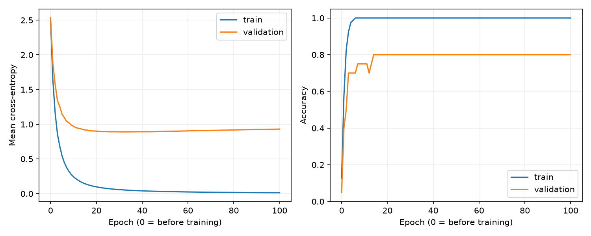

# A first run to interpret

This run used Python 3.14.0, NumPy 2.5.4, and Matplotlib 3.11.2 on CPU.
These are observed results, not promised accuracy for another dataset or setup.

```bash
python train.py --evaluate-test --out runs/verified
```

Default settings: seed 42, 32 hidden neurons, learning rate 0.1, mini-batches
of 16, and 100 epochs. The 100 training-file examples were split into 80 for
training and 20 for validation. No hyperparameter search was performed.

| Measurement | Result |
| --- | --- |
| Initial training loss | 2.5158 |
| Final-epoch training loss | 0.0138 |
| Final-epoch training accuracy | 100% (80/80) |
| Checkpoint selected by validation loss | Epoch 31 |
| Selected validation loss | 0.8903 |
| Selected validation accuracy | 80% (16/20) |
| Majority-class validation baseline | 15% (3/20) |
| Final test accuracy of selected checkpoint | 64.78% (6,478/10,000) |
| Final test loss | 1.1982 |

The training loss keeps falling after validation loss reaches its minimum.
This illustrates why training success and generalization are different. The
20-example validation estimate is noisy; 80% there does not imply 80% on a
larger unseen sample. The test result was observed after selecting the model
by validation loss, and was not used to tune these settings.



The saved model also loaded successfully in `predict.py`, and all six tests
passed, including finite-difference gradient checking and XOR learning.

The next useful improvement is more training data and careful comparisons,
alongside explaining the current calculations yourself. Increasing model size
alone does not solve the shortage of examples.
